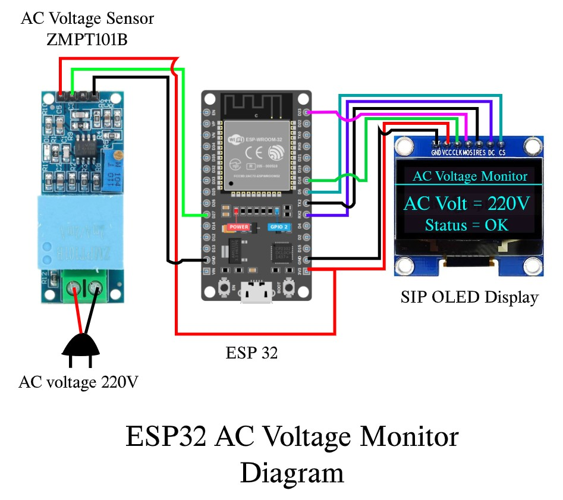
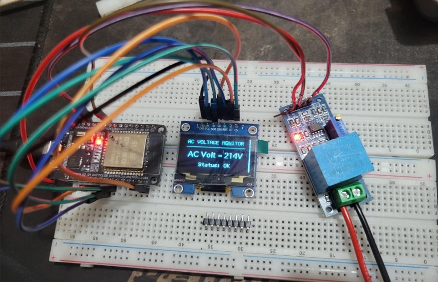

# ESP32 AC Voltage Monitor with OLED Display

An ESP32-based AC voltage monitoring system using the **ZMPT101B AC voltage sensor** and a **128×64 SPI OLED display**. The system measures AC RMS voltage and displays the voltage reading and status in real time.

## Project Images

### Image 1



### Image 2



## Features

- Real-time AC voltage measurement
- ESP32 microcontroller
- ZMPT101B AC voltage sensor
- 128×64 SPI OLED display
- Centered voltage reading, such as `AC Volt = 220V`
- Automatic voltage status detection
- Serial Monitor output
- Adjustable sensitivity and calibration factor

## Hardware Requirements

- ESP32 development board
- ZMPT101B AC voltage sensor module
- 128×64 SPI OLED display
- Jumper wires
- Suitable insulated and enclosed AC test connections

## Connections

### OLED Display to ESP32

| OLED Pin | ESP32 Pin |
|---|---|
| VCC | 3.3V, if supported |
| GND | GND |
| SCK / CLK | GPIO 18 |
| MOSI / SDA / DIN | GPIO 23 |
| CS | GPIO 5 |
| DC / A0 | GPIO 16 |
| RES / RST | GPIO 17 |

### ZMPT101B to ESP32

| Sensor Pin | ESP32 Pin |
|---|---|
| OUT / S | GPIO 27 |
| GND | GND |
| VCC | Compatible module supply |

Check your module's pin labels and voltage requirements before wiring.

## Required Arduino Libraries

Install the following libraries from Arduino IDE Library Manager:

1. **U8g2** by olikraus
2. A compatible **ZMPT101B** library supporting `getRmsVoltage()` and `setSensitivity()`

## Voltage Status Logic

| AC Voltage | Status |
|---|---|
| 0–50V | OFF |
| Above 50V and below 120V | Voltage Error |
| 120V to below 180V | Low Voltage |
| 180–230V | OK |
| Above 230V | High Voltage |

## Calibration

The example code uses:

```cpp
#define SENSITIVITY 500.0f
#define CALIBRATION_FACTOR 1.49f
```

Calibrate the reading against a reliable AC voltmeter. Accuracy depends on the sensor, module adjustment, ADC behavior, and library implementation.

## How to Run

1. Install the Arduino IDE and ESP32 board support.
2. Install the required libraries.
3. Open `esp32-ac-voltage-monitor.ino`.
4. Select your ESP32 board and serial port.
5. Upload the code.
6. Open Serial Monitor at **115200 baud**.

## Safety Warning

Mains AC voltage can cause fatal electric shock. Never connect mains voltage directly to ESP32 GPIO pins. Keep live wiring enclosed and insulated, verify sensor output voltage compatibility, and have mains wiring and calibration handled by a qualified person.

This is an educational prototype, not a certified safety device.

## Future Improvements

- Over-voltage and under-voltage alarms
- Voltage history display
- Minimum and maximum voltage tracking
- Wi-Fi monitoring and web dashboard
- Improved RMS measurement accuracy

## License

Add a `LICENSE` file to specify the terms for using, modifying, and distributing this project.
